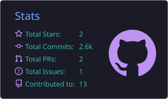
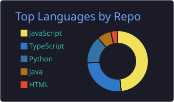
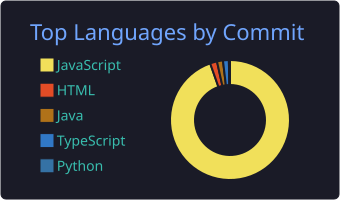
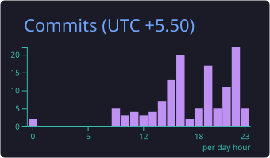

# Hey there, I'm Hirang 👋

**Full-Stack Developer (MERN / Next.js) & AIML Explorer**  
Building real-time web applications, interactive canvases, and AI-powered workflows. Currently diving deep into RAG pipelines, LLM fine-tuning, and open-source architecture.

  
  
  
  

---

### 🛠️ Tech Stack & Focus

- **Full-Stack Engineering:** React, Next.js, Node.js, Express.js, MongoDB, Tailwind CSS, WebSockets
- **AI / ML & GenAI (Learning & Building):** RAG Architectures, LLM Fine-Tuning, Vector Databases, Prompt Engineering, Local LLMs
- **Core CS & Problem Solving:** Data Structures & Algorithms in Java

---

### 🚀 Featured Projects

- 🧠 **AI Research Workspace** — An intelligent workspace engineered to synthesize documents, automate task generation, and query knowledge bases using LLM workflows.
- 🎨 **Drawy** — A collaborative, Excalidraw-inspired infinite whiteboard canvas built for low-latency freehand sketching, diagramming, and real-time state syncing.
- 🏠 **Airbnb Clone** — Full-stack property booking platform built with the MERN stack featuring dynamic filtering, authentication, and listing management.

---

### 🌱 Open Source & Current Exploration

- Actively exploring the codebases, issue trackers, and local dev setups of **[Rocket.Chat](https://github.com/RocketChat/Rocket.Chat)** and **[n8n](https://github.com/n8n-io/n8n)** to ship my first upstream contributions.
- Experimenting with end-to-end **Retrieval-Augmented Generation (RAG)** and fine-tuning small open-weight language models.

---

## 🧩 LeetCode

<!-- Hosted image, no workflow needed. -->

  

---

## 📊 GitHub

<!--
  These images are generated by GitHub Actions (.github/workflows) and stored in this repo,
  so they don't depend on third-party servers.
  Change "tokyonight" below to any theme: default, dracula, github_dark, nord_dark, radical, solarized_dark, zenburn...
-->

  

<picture>
  <source media="(prefers-color-scheme: dark)" srcset="https://raw.githubusercontent.com/HirPtl10/HirPtl10/output/github-snake-dark.svg" />
  <source media="(prefers-color-scheme: light)" srcset="https://raw.githubusercontent.com/HirPtl10/HirPtl10/output/github-snake.svg" />
  
</picture>

